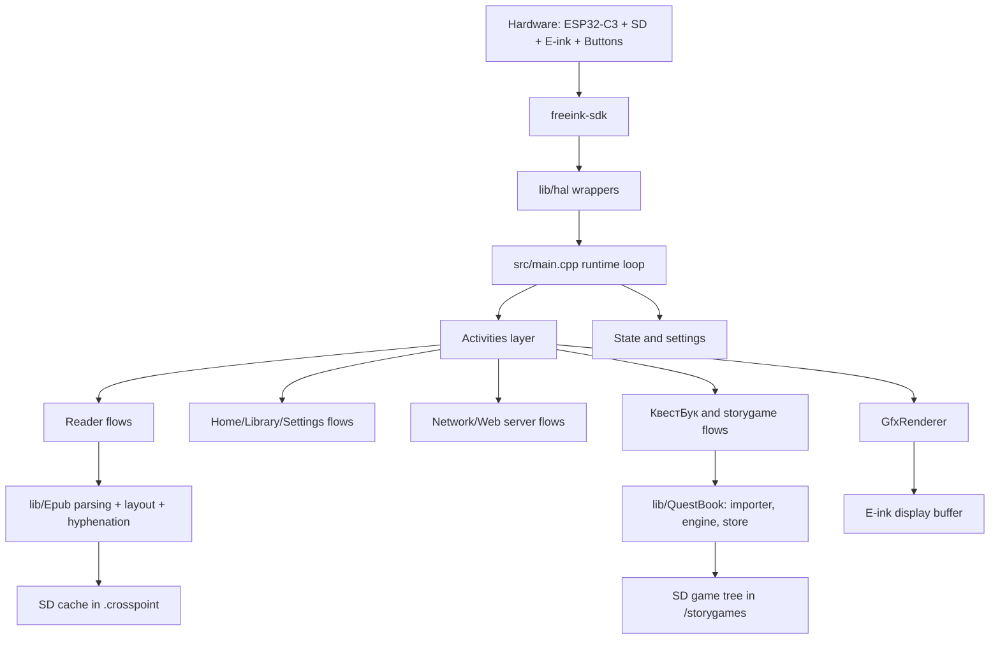
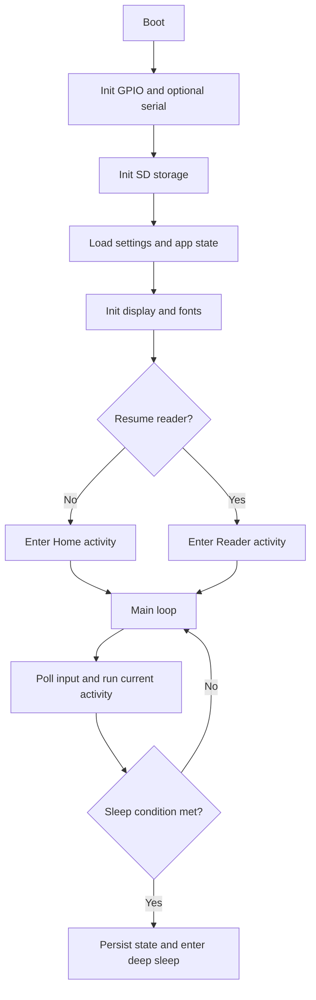
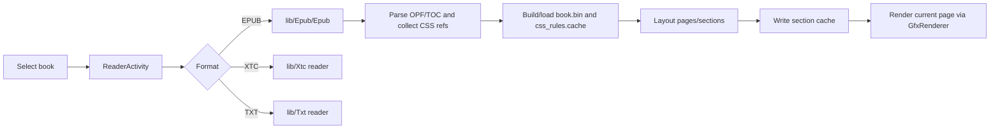
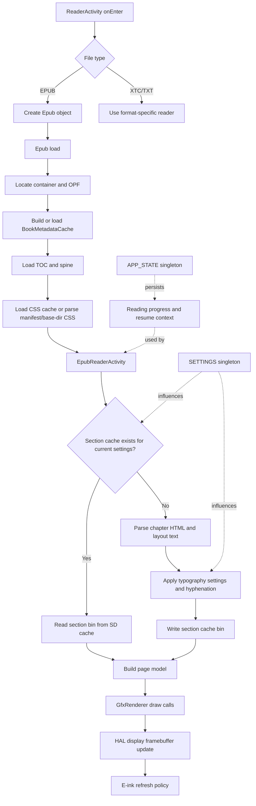
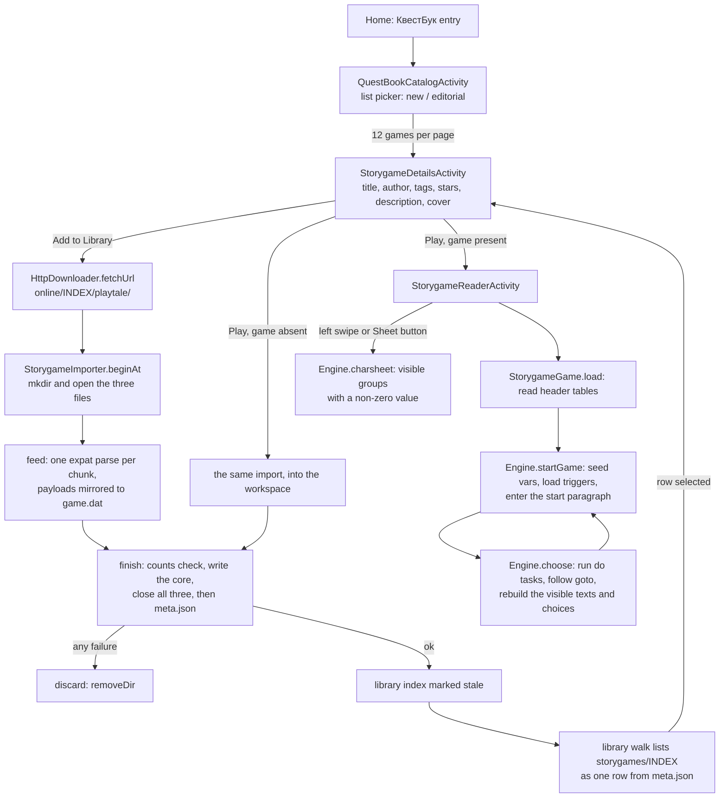
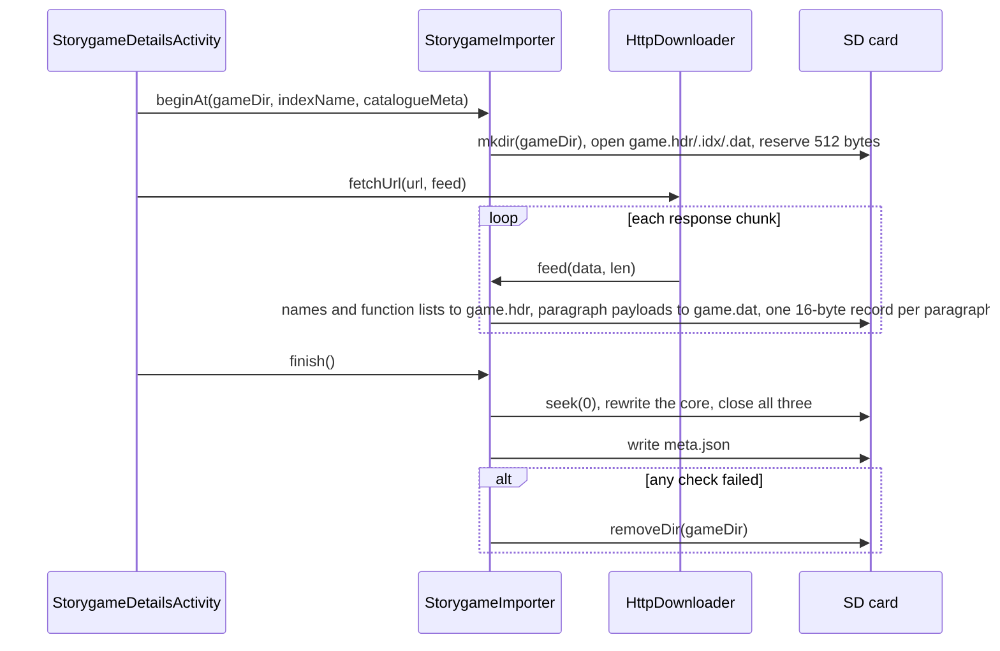
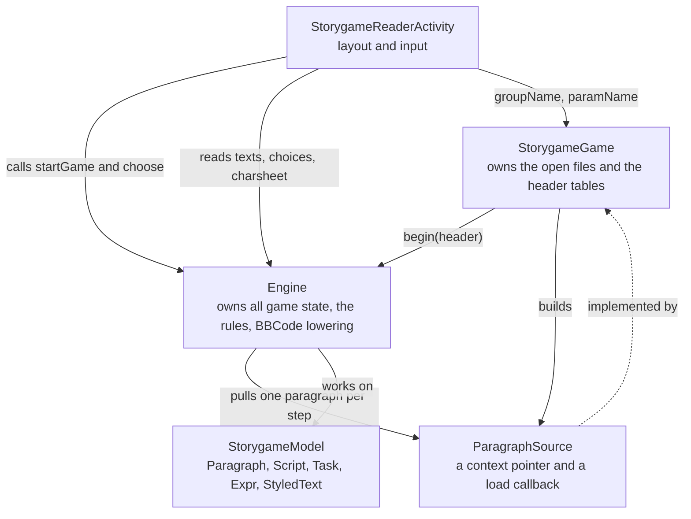
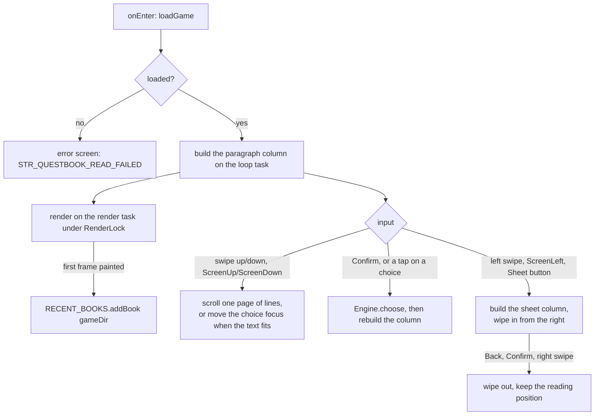
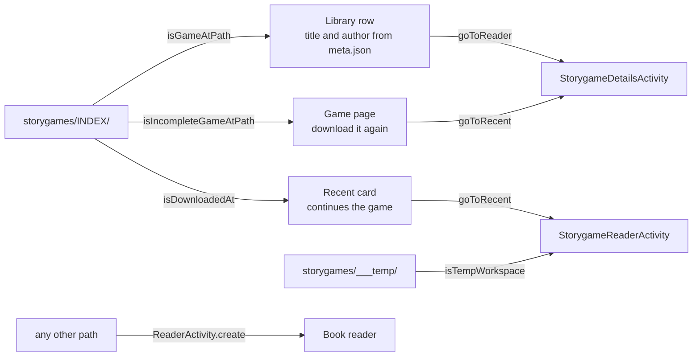

# Architecture Overview

PlayTale is the firmware behind КвестБук Читалка, built with PlatformIO. The
Xteink X4 (ESP32-C3, unaffiliated with Xteink) remains the resource baseline:
its RAM, flash, and panel limits shape most decisions. Several ESP32-S3 boards
are also built from this repository: Xteink X4 Pro, Xteink X4 Classic, Seeed
reTerminal Sticky, and M5Stack Paper Mono. The Xteink X3 is discontinued and
unsupported (its environment may still compile).

At a high level, it is firmware that uses an activity-driven application architecture loop with persistent settings/state, SD-card-first caching, and a rendering pipeline optimized for e-ink constraints.

It serves two content kinds. **Books** (EPUB 2/3, plus TXT/Markdown through the
same reflowable pipeline, and XTC for pre-rendered pages) go through
`lib/Epub` and the paginated reader. **Storygames** — interactive gamebooks from
quest-book.ru — go through a separate subsystem: a downloaded game tree on the
SD card, a rule engine in `lib/QuestBook`, and a scrolling reader activity.
They share the HAL, the renderer, the activity loop, the library index, the
recent-books store, and the font/hyphenation services, and nothing else. The
storygame subsystem owns its formats, its parser, its engine and its screen; see
[Storygames](#storygames) below and
[Storygames on the SD card](../file-formats.md#storygames-on-the-sd-card) for the
byte layout.

## System at a glance



## Runtime lifecycle

Primary entry point is `src/main.cpp`.



In each loop iteration, the firmware updates input, runs the active activity, handles auto-sleep/power behavior, and applies a short delay policy to balance responsiveness and power.

## Activity model

Activities are screen-level controllers deriving from `src/activities/Activity.h`.
Some flows use `src/activities/ActivityWithSubactivity.h` to host nested activities.

- `onEnter()` and `onExit()` manage setup/teardown
- `loop()` handles per-frame behavior
- `skipLoopDelay()` and `preventAutoSleep()` are used by long-running flows (for example web server mode)
- `render(RenderLock&&)` runs on the render task; anything the loop task mutates for the frame must be written under the same `RenderLock`

Top-level activity groups:

- `src/activities/home/`: home and library navigation
- `src/activities/reader/`: EPUB/XTC/TXT reading flows and the storygame reader
- `src/activities/browser/`: OPDS, plugin catalogs, and the КвестБук catalogue and game page
- `src/activities/settings/`: settings menus and configuration
- `src/activities/network/`: Wi-Fi selection, AP/STA mode, file transfer server
- `src/activities/boot_sleep/`: boot and sleep transitions

`ActivityManager` owns dispatch. `goToReader(path)` decides between the BMP
viewer, the storygame surfaces and `ReaderActivity::create()`; `goToRecent(path)`
decides between continuing a storygame and opening a book. Both consult the
storygame store's predicates rather than extension alone — see
[Library, recents and navigation](#library-recents-and-navigation).

## Reader and content pipeline

Reader orchestration starts in `src/activities/reader/ReaderActivity.h` and dispatches to format-specific readers.
EPUB processing is implemented in `lib/Epub/`.



Why caching matters:

- RAM is limited on ESP32-C3, so expensive parsed/layout data is persisted to SD
- repeat opens/page navigation can reuse cached data instead of full reparsing

Storygames do not enter this pipeline. A game is not reflowable source that gets
parsed and laid out per section: it is a prepared tree whose per-step work is one
index read and one payload parse, so it has its own reader and none of the EPUB
caches. See [Storygames](#storygames).

## Reader internals call graph

This diagram zooms into the EPUB path to show the main control and data flow from activity entry to on-screen draw.



Notes:

- CSS files are collected from the OPF manifest and, when needed, discovered by
  streaming ZIP paths under the OPF content base directory; the firmware avoids
  preloading the full ZIP central directory for large books.
- "section cache exists" depends on cache-busting parameters such as font,
  viewport size, paragraph alignment, hyphenation, embedded CSS, image rendering,
  and Focus Reading settings
- rendering favors reusing precomputed layout data to keep page turns responsive on constrained hardware
- progress/session state is persisted so the reader can reopen at the last position after reboot/sleep

## State and persistence

Two singletons are central:

- `src/CrossPointSettings.h` (`SETTINGS`): user preferences and behavior flags (the source file names are not renamed yet; branding strings such as `STR_QUESTBOOK_READER` and `STR_QUESTBOOK` live in the translation files)
- `src/CrossPointState.h` (`APP_STATE`): runtime/session state such as current book and sleep context

Typical persisted areas on SD:

```text
/.crosspoint/
  epub_<hash>/
    book.bin
    css_rules.cache
    progress.bin
    cover.bmp
    sections/*.bin
    img_* cache files
  qbcover/
    <md5>_v1_128x192.bmp      storygame cover cache, one file per game
  settings.json
  state.json
  recent.json                 recent books and games, max 10 entries
  library.idx                 CLX1 library index, one record per book or game
/storygames/
  <index_name>/               a downloaded storygame: five files, one Library row
  ___temp/                    Play's shared workspace, one game, never listed
```

`sections/*.bin` contains rendered pages plus anchor, paragraph, list-item, and
page-start visible-text-offset lookup tables. The offset table makes reading
positions content-based: KOReader XPaths resolve to an exact chapter offset,
and the current layout derives the corresponding page. For binary cache
formats, see `docs/file-formats.md`.

Setting `/.crosspoint` aside, a storygame lives outside the cache root on
purpose: it is content, not derived data, and no cache clear should delete it.
The cover cache under `/.crosspoint/qbcover/` *is* derived and is reclaimed by
Settings → Clear cache, while a game's own `cover.bmp` survives.

## Storygames

Storygames are one subsystem with five cooperating layers, all under
`lib/QuestBook/` plus one screen. The split matters because only the outermost
layers need the HAL: the rules and the payload grammar are testable on the host.

| Layer | Module | Owns | HAL dep. |
|---|---|---|---|
| Catalogue | `QuestBookListParser` | one page of the service's JSON list | no (`StreamingJsonParser`) |
| Import | `StorygameImporter` | the `/playtale/` document → the on-SD tree | yes (expat, `HalStorage`) |
| Storage policy | `StorygameStore`, `StorygameFormat`, `StorygameMeta` | paths, "is this a game?", deletion, `meta.json` | partly (`meta.json` reading is inline) |
| Runtime | `StorygameEngine`, `StorygamePayload`, `StorygameGame`, `StorygameModel` | rules, payload parsing, on-demand paragraph loading | `Engine`/`Payload` no; `Game` yes |
| Presentation | `StorygameReaderActivity` | the scrolling column and the character sheet | yes |

The formats themselves are specified in
[Storygames on the SD card](../file-formats.md#storygames-on-the-sd-card). The
design rationale, corpus measurements and the service contract are in
[docs/storygames/ARCHITECTURE.md](../storygames/ARCHITECTURE.md). This section
covers how the pieces fit and why.

### What a storygame is, and what the device therefore needs

A storygame author writes data, not code. A game file is a set of paragraphs,
each with text, choices and small declarative task lists; the only executable
code in it is a fixed platform framework that is identical in every game. So the
device does not run a JavaScript engine. It reimplements the framework once,
natively:

- a **condition evaluator** for three expression types (`k` flag set, `r` counter
  compared, `s` free-text arithmetic expression);
- a **task interpreter** for the declarative operation classes (`set`, `inc`,
  `dec`, `if`, `fun`, `rnd`, …);
- a **BBCode lowering** pass from the platform's markup to styled runs;
- the **character sheet** as a data query over the parameter tables.

This is why the subsystem carries no scripting dependency and why its rules
compile on the host. `lib/QuestBook/StorygameEngine.h:9-13` states the boundary:
the engine reads no files and needs no expat; paragraph loading arrives through
a `ParagraphSource` callback supplied by whoever owns the tree.

### End-to-end flow



Reading it as two halves is the useful split: **the import half is a streaming
writer** (network → SD, one pass, no document held), and **the play half is a
bounded random-access reader** (one 16-byte index read, one payload, no parse of
the rest of the game).

### The import: streaming writer

`StorygameImporter` is an expat SAX handler with three output files open. It does
not open the network itself: the game page pumps it with `HttpDownloader`'s data
callback, so the importer's only external dependency is the filesystem.



Properties worth keeping when changing it:

- **The document is never held.** Payloads are mirrored to `game.dat` as they
  arrive, so the largest game (2.46 MB, one 72 KB paragraph) costs a chunk
  buffer, not a document buffer.
- **The heap it holds is the three tables**, sized once from the document's
  `<counts>` and capped at 11 264 bytes (`MAX_TABLE_BYTES`). Nothing else grows
  with the document.
- **Offsets never depend on a card round-trip.** The importer counts the bytes it
  wrote itself.
- **`meta.json` last is the commit marker.** It is the only file whose absence is
  recoverable, which is what makes a power cut a retry instead of a corrupt
  game.
- **Every in-session failure deletes the directory.** There is no partial state
  that reads as playable.
- **It refuses to write anywhere but a game directory or the workspace**, so a
  caller cannot aim it at an arbitrary path.

### The runtime: bounded reader



`StorygameGame` reads the header tables into three vectors at load, parses each
function's task list once, then serves paragraphs on demand through
`ParagraphSource`. Its payload buffer grows only when a larger paragraph arrives
and is **released after every parse**, so a 96 KiB buffer never stays pinned
while the reader renders.

`Engine` holds all game state:

| State | Type | Meaning |
|---|---|---|
| `vars_` | `vector<int32_t>` indexed by parameter ordinal | the whole game state; 322 parameters at the measured maximum is 1 288 bytes |
| `steps_` | `int32_t` | paragraph entries, incremented per non-bootstrap entry |
| `lastOrdinal_` | `int32_t` | the paragraph `back` returns to |
| `current_`, `haveCurrent_` | ordinal + flag | the current paragraph |
| `texts_`, `choices_` | resolved vectors | the current paragraph *after* conditions, ready to draw |
| `pendingTransition_`, `pendingTarget_`, `pendingClearLast_` | transition intent | a `goto`/`back` recorded mid-list so a paragraph swap never invalidates the list still executing |

Step semantics that a change must preserve:

- **Entry**: load the target payload before touching the current paragraph, run
  the outgoing paragraph's `unload` tasks, install the new paragraph, run its
  `preload` tasks, increment `steps_`, then rebuild the visible view.
- **A dead link is not fatal.** A `goto` or choice naming an absent paragraph
  leaves the reader on the current paragraph with its choices still usable. Only
  the entry paragraph is fatal (`Engine::moveTo`, `Engine::choose`).
- **Offline save model**: a new game always starts from the parameters' declared
  start values, `save` and `achi` are no-ops, and progress is not persisted yet.
- **Conditions** combine with AND or OR, and carry the reference's own `crit`
  and `not` inputs rather than a normalised predicate, because collapsing them is
  easy to get subtly wrong.
- **An unknown task class is a logged no-op**, never a paragraph failure.
- **The `_mitril_triggers` paragraph is appended to every paragraph**, which is
  how a game implements a global rule such as "if health ≤ 0, go to the death
  ending".

### The presentation layer

`StorygameReaderActivity` is its own activity, not a `ReaderActivity` subclass:
pages, reading sessions, and the remote page-turner do not apply to a
choice-based game, and the game's text is a *scrolling column* rather than a
paginated one.



Design points that are easy to break:

- **Two resident columns, not one.** While the sheet is open the paragraph is
  still on screen behind the wipe, so it cannot be released. Each column keeps its
  line-array capacity across rebuilds, so after the first paragraph and the first
  sheet opening a rebuild reuses the same block instead of reallocating.
- **Lines own exactly one copy of their text** (`text` holds the whole line,
  `spans` are styled slices), so a long paragraph costs its length once, not once
  per word.
- **Layout and drawing share the measurement.** `fui::layoutText()` is used both
  to measure and to draw, so a scroll offset cannot disagree with a measured
  height. Hyphenation follows the reader's setting, runs on Russian patterns
  (the format carries no language), and applies to paragraph prose only — a
  hyphen inside a choice's label reads as a typo.
- **Everything the loop task mutates for the frame is written under
  `RenderLock`**, because the render task may be painting.

### Library, recents and navigation

A downloaded game is one record of the existing library index (`CLX1`), exactly
like a book; the paragraph records are the game's own `game.idx`, not `CLX1`
records. The library walk lists `/storygames/<index_name>` as one item, takes its
title and author from the game's `meta.json`, and never descends into it.



`goToReader()` and `goToRecent()` are deliberately different: a **Library row is
a shelf entry**, so it opens the game's page where the game is downloaded or
removed; a **recent card means "continue this"**, so it starts the reader. The
shared predicates in `StorygameStore.h` are what keep a book file that happens to
sit in `/storygames/` opening as a book.

Home returns to the surface the page was opened from, which is why the page has
two activity names (`StorygameDetails` for the catalogue, `StorygameDetailsLibrary`
for the library) — `ActivityManager::goHome()` dispatches on the name.

### Resource cost

| Operation | Peak heap | Notes |
|---|---|---|
| Catalogue page | ~15–18 KB | 16 rows of capped strings; arithmetic from the parser's caps, not measured |
| Game import | 11 264 B tables + one parser + chunk buffer | none of it grows with the document |
| TLS session | ≥ 40 KB free, ≥ 20 KB largest block | the floor both transfers check before starting (`HttpDownloader::MIN_TLS_*`) |
| Paragraph read | ≤ 96 KiB, released after parse | median 1 185 B, max 72 279 B measured |
| Header tables at play | 16 B/group, 16 B/param, 32 B/function + task lists | ~5.4 KB for the largest measured game |
| Game state | 4 B/parameter | 1 288 B at the measured maximum |

The import and the reader never overlap: the reader is opened after the import
returns. The cover transfer runs on the main task after the first frame is on the
panel, so the page's text is visible before the session allocates.

### What is not built

Recorded here so a reader does not assume it: **progress and parameter
persistence**. A game always starts from its entry paragraph, and `save`/`achi`
tasks are inert. There is no `state.bin` on the card and no per-game save file;
`ROADMAP.md` carries the plan. Also unbuilt: a tag screen and substring search
(the service's JSON API has neither, see
[ARCHITECTURE.md](../storygames/ARCHITECTURE.md) §2.3–2.4), paragraph images
(omitted by the converter), and accounts.

### Testing

The rules layer is host-testable, which is unusual for this project and worth
keeping:

| Suite | Covers |
|---|---|
| `test/storygame_engine` | conditions, task classes, transitions, BBCode lowering, the character sheet |
| `test/storygame_payload` | the `<p>`/`<fn>` payload grammar and its bounds |
| `test/storygame_format` | field offsets, strides, path rules, the workspace, `meta.json` reading |
| `test/library_builder`, `test/questbook_cover`, `test/questbook_list_parser` | the surrounding integration |

`StorygameFormatTest` asserts `offsetof` for every `HeaderCore` field, so
reordering the on-SD contract breaks the build instead of the card. Run them as
described in [test/README](../../test/README).

## Networking architecture

Network file transfer is controlled by `src/activities/network/CrossPointWebServerActivity.h` and served by `src/network/CrossPointWebServer.h`.

Modes:

- STA: join existing Wi-Fi network
- AP: create hotspot
- Calibre Wireless: STA flow specialized for Calibre plugin uploads

Server behavior:

- HTTP server on port 80
- WebSocket upload server on port 81
- WebDAV handler on the HTTP server
- UDP discovery listener for upload clients
- file operations backed by SD storage
- browser APIs for file management, settings, fonts, OPDS servers, and saved Wi-Fi networks
- activity requests faster loop responsiveness while server is running

Endpoint reference: `docs/webserver-endpoints.md`.

## Build-time generated assets

Some sources are generated and should not be edited manually.

- `scripts/build_html.py` generates `src/network/html/**/*.generated.h` from the HTML, JS, CSS, and SVG
  files under `src/` (today only `src/network/html/`). It minifies JS and CSS with the vendored rjsmin and rcssmin
  (`scripts/vendor/`), except pre-minified `*.min.js` files. The build stops on JS that rjsmin
  would corrupt: a template literal nested inside another one's `${...}`, or a regex literal
  after a character rjsmin does not expect, such as `x => /re/` (write `x => (/re/)`).
- `scripts/gen_i18n.py` generates `lib/I18n/I18nKeys.h`, `I18nStrings.h`, and `I18nStrings.cpp`
- `scripts/generate_hyphenation_trie.py` generates hyphenation headers under `lib/Epub/Epub/hyphenation/generated/`

When editing related source assets, regenerate via normal build steps/scripts.

## Key directories

- `src/`: app orchestration, settings/state, and activity implementations
- `src/network/`: web server and OTA/update networking
- `src/components/`: theming and shared UI components
- `lib/hal/`: hardware abstraction wrappers around freeink-sdk
- `lib/Epub/`: EPUB parser, layout, CSS handling, and hyphenation
- `lib/QuestBook/`: the КвестБук catalogue parser, the storygame importer, the
  on-SD format, and the rules engine
- `lib/LibraryIndex/`: the `CLX1` library index — books and downloaded games
- `lib/`: supporting libraries (fonts, text, filesystem helpers, etc.)
- `freeink-sdk/`: hardware SDK submodule (display, input, storage, battery). Docs: https://freeink.org/docs
- `test/`: host gtest suites, including the storygame engine, payload and format
- `docs/`: user and technical documentation

## Embedded constraints that shape design

- constrained RAM drives SD-first caching and careful allocations
- e-ink refresh cost drives render/update batching choices
- main loop responsiveness matters for input, power handling, and watchdog safety
- background/network flows must cooperate with sleep and loop timing logic
- the storygame work adds no scripting engine and no database: the rules are a
  hand-written interpreter over an integer array, and the store is a fixed-stride
  index, because that is what the C3's budget allows

## Scope guardrails

Before implementing larger ideas, check:

- [SCOPE.md](../../SCOPE.md)
