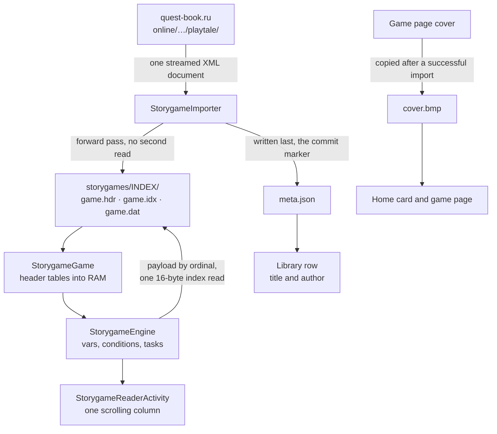
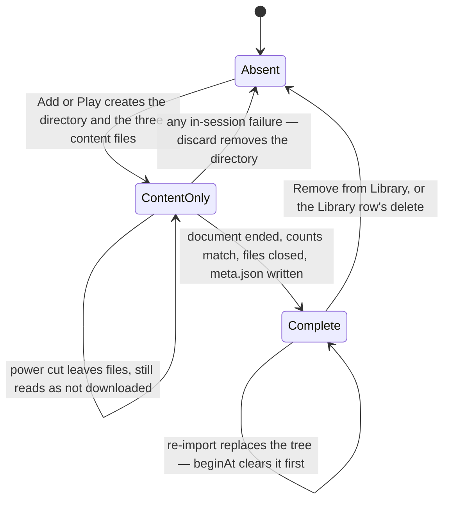

# File Formats

These formats describe the SD-card files this firmware writes: everything under
`/.crosspoint/`, from the per-book EPUB caches to the storygame cover cache, and
the `/storygames/` game tree at the card root. КвестБук Читалка (PlayTale)
keeps the upstream `/.crosspoint/` directory name (not renamed yet), because
existing cards already store their caches there. All POD fields are written in
the ESP32 little-endian representation used by `Serialization.h`. String framing
is per format: length-prefixed in the caches, offset+length inside `game.hdr`,
and JSON in `meta.json`.

Two stores are not caches and have no migration: the library index
(`CLX1`, `/.crosspoint/library.idx`) and the storygame tree
(`/storygames/`). The storygame tree is specified in full — layout, commit
protocol, every record field and the paragraph payload grammar — under
[Storygames on the SD card](#storygames-on-the-sd-card); remove a game with
**Remove from Library**, not by hand, because its directory is one library
record.

| Store | Path | Reclaimed by |
|---|---|---|
| EPUB per-book cache | `/.crosspoint/epub_<hash>/` | Clear cache, or deleting the book |
| Library index | `/.crosspoint/library.idx` | Rebuilt when stale; never migrated |
| Storygame tree | `/storygames/<index_name>/` | **Remove from Library**, or the Library row's delete |
| Storygame workspace | `/storygames/___temp/` | The next Play of another game, or deleting its recent card |
| Storygame cover cache | `/.crosspoint/qbcover/` | Settings → Clear cache (a game's own `cover.bmp` is kept) |

## `book.bin`

### Version 10

`book.bin` stores EPUB metadata plus lookup tables for spine and TOC entries.
The current firmware writes this version from `BookMetadataCache`.

ImHex pattern:

```c++
import std.mem;
import std.string;
import std.core;

#define EXPECTED_VERSION 10
#define MAX_STRING_LENGTH 65535

struct String {
    u32 length [[hidden, comment("String byte length")]];
    if (length > MAX_STRING_LENGTH) {
        std::warning(std::format("Unusually large string length: {} bytes", length));
    }
    char data[length] [[comment("UTF-8 string data")]];
} [[sealed, format("format_string"), comment("Length-prefixed UTF-8 string")]];

fn format_string(String s) {
    return s.data;
};

struct Metadata {
    String title [[comment("Book title")]];
    String author [[comment("Book author")]];
    String language [[comment("Book language code")]];
    String coverItemHref [[comment("Path to cover image")]];
    String textReferenceHref [[comment("Path to guided first text reference")]];
};

struct SpineEntry {
    String href [[comment("Resource path")]];
    u32 cumulativeSize [[comment("Cumulative uncompressed spine size through this entry")]];
    s16 tocIndex [[comment("Index into TOC, or inherited/previous TOC index when no direct entry exists")]];
};

struct TocEntry {
    String title [[comment("Chapter/section title")]];
    String href [[comment("Resource path")]];
    String anchor [[comment("Fragment identifier")]];
    u8 level [[comment("Nesting level")]];
    s16 spineIndex [[comment("Index into spine (-1 if none)")]];
};

struct BookBin {
    u8 version;
    if (version != EXPECTED_VERSION) {
        std::error(std::format("Unsupported version: {} (expected {})", version, EXPECTED_VERSION));
    }

    u32 lutOffset [[comment("Offset to lookup tables")]];
    u16 spineCount;
    u16 tocCount;

    Metadata metadata;

    u32 currentOffset = $;
    if (currentOffset != lutOffset) {
        std::warning(std::format("LUT offset mismatch: expected 0x{:X}, got 0x{:X}", lutOffset, currentOffset));
    }

    u32 spineLut[spineCount] [[comment("Spine entry offsets")]];
    u32 tocLut[tocCount] [[comment("TOC entry offsets")]];

    SpineEntry spines[spineCount];
    TocEntry toc[tocCount];
};

BookBin book @ 0x00;

u32 fileSize = std::mem::size();
u32 parsedSize = $;
if (parsedSize != fileSize) {
    std::warning(std::format("Unparsed data detected: {} bytes remaining at offset 0x{:X}", fileSize - parsedSize, parsedSize));
}
```

## `section.bin`

### Version 73

Version 73 keeps the binary layout and rebuilds completed and partial sections.
TrueType vector fonts now render and advance the .notdef glyph for missing
characters instead of omitting them. Cached line breaks and word positions change
for text containing glyph fallbacks. Book metadata and saved progress are kept.

### Version 72

Version 72 makes ruby layout closer to how Chromium browser render text with
ruby characters by default (`ruby-align: space-around; ruby-overhang: auto;`)
Ruby annotation can overhang neighboring base text by at most the smaller of
half the ruby edge-character width and 1/4 of the neighboring word width. When
the ruby annotation is wider than its base text, spacing is inserted between
every character in the base text as well as at the start and the end of the
base text so that it becomes the same length as the ruby annotation.

### Version 71

Version 71 keeps the binary layout and rebuilds completed and partial sections.
Focus split offsets now locate the bold prefix in RTL words and the regular
suffix in LTR words. Book metadata and saved progress are kept.

### Version 70

Version 70 preserves the binary layout but rebuilds completed and partial
sections because SD-font layout now rounds each scaled glyph advance to pixels,
matching unkerned drawing. Cached line breaks and word positions change.
Book metadata and saved progress are kept.

### Version 69

Version 69 preserves the binary layout but rebuilds completed and partial
sections because line spacing now multiplies font size instead of the font's
newline distance (`advanceY`). Clipping layout signatures also distinguish the
new calculation so old page-local word ranges are not reused for a new layout.
Book metadata and saved progress are kept.

### Version 68

Version 68 preserves the binary layout but rebuilds completed and partial
sections to remove mid-line hyphens left by drop-cap layout. The lines beside
the drop cap use bounded greedy wrapping; the rest keep their usual wrapping.
Book metadata and saved progress are kept.

### Version 67

Version 67 preserves the binary layout but rebuilds completed and partial
sections for corrected justification of visually reordered text with attached
spaces. Book metadata and saved progress are kept.

### Version 66

Version 66 preserves the binary layout but rebuilds completed and partial
sections to remove leading non-breaking spaces carried across soft line wraps.
Explicit paragraph-leading spaces, book metadata, and saved progress are kept.

### Version 65

Version 65 preserves the binary layout but rebuilds completed and partial
sections for corrected justification of non-breaking spaces after hyphens and
ellipses. Book metadata and reading progress are unchanged.

### Version 64

Version 64 preserves the binary layout but rebuilds completed and partial
sections for corrected explicit font-weight/font-style inheritance. It retains
version 63's GIF rendering and paragraph-boundary fixes. CSS cache version 19 stores
`inherit` as value 2 in the existing font-style and font-weight bytes; the
winning declaration is resolved against the parent before applying the element's
style. Older CSS caches are rebuilt. Book metadata and reading progress are
unchanged.

### Version 63

Version 63 retains the version 60 rendering format and rebuilds completed and
partial sections to include previously omitted GIFs and their alternative text.
Earlier GIF/table development builds used versions 60 through 62; their caches
also rebuild to preserve both the current rendering format and corrected
paragraph boundaries. The partial-build sentinel remains derived from the final
section version. Book metadata and saved progress are kept, but pagination can
change as GIFs become visible.

### Version 60

The serialized layout is unchanged. Text that runs straight into a block or
heading start (`text<div>…`) now stays in its own paragraph instead of being
joined to the first word of the new block. Older completed and partial section
caches rebuild automatically; book metadata and reading progress are kept.

### Version 59

The serialized layout is unchanged. Stored CSS rules now apply even below
48 KiB free heap. Older completed and partial sections rebuild because they may
contain missing styles, different line breaks, or content that should be hidden.
Book metadata, CSS rule caches, and reading progress are kept.

### Version 58

The serialized layout is unchanged. Completed and partial sections rebuild for
corrected rendering layout and footnote placement. Book metadata and reading
progress are kept.

### Version 57

Version 57 combines the rendering layout below with line breaks after explicit
hyphens and dashes. It invalidates version 56 caches from both branches, which
used different layouts under the same version. Completed and partial sections
are rebuilt.

### Version 56

Version 56 adds the rendering layout below on top of version 55.

Each TextBlock's BlockStyle stores a signed 32-bit `fontId` after
`characterSpacing`: the renderer font the line was laid out in, or 0 for the
section font. Each TextBlock ends with a `hasWordFonts` flag. When set, it is
followed by three signed 32-bit font ids and one slot byte per word: 0 draws the
word in the block's font, `n` in font `n - 1`; bit 0x80 of a slot marks CSS
small caps (the word text keeps its original case). Mixed-size words share the baseline
of the tallest font. SD (.cpfont) and vector fonts use sized variants for
headings, CSS font-size blocks, inline runs and drop caps. A font-size span
holding a whole paragraph sizes that paragraph.

Pages gain two element types. `TAG_PageDropCap` (4) is an initial letter drawn
scaled up from a font's glyph: position (its `yPos` is the baseline of the last
spanned line), the renderer font id, the scale in 1/256ths, the word style and
up to 12 bytes of UTF-8 text. `TAG_PageBorderBox` (5) is a CSS border and/or
background shade around one page's slice of a block element: position, size,
width and style for the top, right, bottom and left edges (a side split off by a
page break has width 0), and a shade flag.

Layout changes keep headings with following content and avoid leaving a
paragraph's first line alone at a page bottom or its last line alone at a page
top. Preserved whitespace and inherited block emphasis affect word placement
and styles. Inline `<br>` breaks omit paragraph spacing, while standalone and
consecutive breaks add blank lines.

Table columns are sized from a markup pre-scan rather than equal widths.
Bordered tables frame each grid cell with `PageBorderBox` elements. Cells honor
CSS padding in grid and stacked layouts. Plain-text rows share a 160-token /
2 KB budget; rows containing blocks or images use full-width flow to preserve
paragraphs and illustrations. Older sections are rebuilt for the serialized
font data, page elements and layout changes.

CSS cache version 16 adds a boolean `preserveWhitespace` byte after `initialLetter`
and uses defined-property bit 30 for `white-space`.
CSS cache version 17 stores rules in source order and retains nonadjacent repeated
selectors so equal-specificity declarations cascade in stylesheet order.

CSS cache version 18 adds a border-component byte after the four border sides.
Bits 0-3 mark declared widths and bits 4-7 mark declared styles, in top, right,
bottom, left order. Width and style declarations cascade independently.

### Version 55

Each TextBlock adds a uint16 `paragraphStartWord` after `textBytes`. It is the
visual index of the paragraph's first logical word, or `UINT16_MAX` for a
continuation line. Clipping uses this marker independently of source-offset
gaps. Older completed and partial section caches rebuild automatically;
book metadata and reading progress are kept.

### Version 54

The serialized layout is unchanged. Word source ranges and split offsets now
include codepoints absorbed by NFC composition. The high bit of each word's
style byte marks a discretionary hyphen, so clipping can remove it independently
of source length. Rebuild completed and partial section caches to correct
clipping spaces and anchors for decomposed text.

### Version 53

Each TextBlock arena starts with one 8-byte source range per word (two uint32
chapter-visible Unicode-codepoint offsets, start inclusive and end exclusive).
Ranges follow words through BiDi ordering and line wrapping. This version also
includes the version 52 redaction layout changes. Older completed and partial
section caches are rebuilt automatically; book and progress files are kept.

### Version 52

The serialized layout is unchanged. Missing full-block (`U+2588`) and black-square
(`U+25A0`) symbols now use font-sized solid rectangles instead of replacement
glyphs. Rebuild older sections so cached line breaks and word positions match
their new widths.

### Version 51

The serialized layout is unchanged. Paragraph continuity and top spacing are
preserved across soft flushes. Older sections are rebuilt for the updated layout.

### Version 50

The header adds `paragraphIndentSpaces` after `extraParagraphSpacing`. The value
participates in cache validation, so sections with different indentation settings
are rebuilt. Version 49 was used by pre-release builds with a different header
layout and is skipped to prevent reuse of those caches.

### Version 48

Version 48 keeps the version 47 serialized layout unchanged. It was bumped
because Hangul text no longer has implicit line-break opportunities between
syllables: Korean words wrap at spaces (like CSS `word-break: keep-all`), and
with hyphenation enabled a word may also split at the end of a line wherever the
CJK line-breaking rules allow, without an inserted hyphen. Justification stretches only word spaces. Cached line breaks and word
positions from version 47 no longer match.

### Version 47

The section header adds signed `characterSpacing` (pixels) and unsigned
`wordSpacingPercent` after `focusReadingEnabled`; both participate in cache
validation. Each TextBlock's BlockStyle stores only `characterSpacing` after
`directionDefined`. Word spacing is resolved into cached word positions during
layout. Sections from earlier versions are rebuilt.

### Version 46

Version 46 keeps the version 45 serialized layout unchanged. It was bumped
because ordered lists now number their items, `list-style-type: none`
suppresses list markers, and `<ul>`/`<ol>` containers contribute their own
margins and padding to child block insets, changing cached word contents and
page layout.

### Version 45

Version 45 keeps the version 44 serialized layout unchanged. It was bumped
because internal EPUB links now preserve CSS superscript and subscript styles,
changing their cached word-style flags and page layout.

### Version 44

Each file in `sections/*.bin` stores one laid-out spine section. The header is
also the cache-busting key: if any layout-affecting setting differs from the
current reader settings, the section is discarded and rebuilt.

Version 44 appends the internal-link rectangles produced during text layout to
each serialized page. The reader uses these rectangles for touch navigation;
older caches are rebuilt because they contain no link geometry.

Version 43 keeps the version 42 serialized layout unchanged. It was bumped
because paragraph base direction now excludes direction changes from inline
elements.

Version 42 keeps the version 41 serialized layout unchanged. It was bumped
because closing a block now strips inherited vertical margins and padding.

Version 41 keeps the version 40 serialized layout unchanged. It was bumped
because simple HTML table rows are now laid out as positioned columns rather
than flattened paragraphs with synthetic row/cell labels.

Version 40 keeps the version 39 serialized layout unchanged. It was bumped
because ruby groups now remain intact when large text blocks are soft-flushed.

Version 39 keeps the version 38 serialized layout unchanged. It was bumped
because image top margins are now clamped to keep full-height images within the
page viewport.

Version 38 keeps the version 37 serialized layout unchanged. It was bumped
because Focus Reading now permits line breaks at visible hyphens and dashes
and hyphenates focus-split words as a whole, changing cached page layout.

Version 37 increases the fixed-size footnote href field from 96 to 256 bytes.
This changes each serialized footnote record from 128 to 288 bytes, so older
section caches must be discarded and rebuilt.

Version 36 keeps the version 35 serialized layout unchanged. It was bumped
because ruby and justified text positioning and CJK line breaking now use
corrected word measurements, so version 35 cached page layouts no longer match.

Version 35 adds a header offset and a `uint32_t` entry per page for the
visible-text offset LUT. The other section LUTs remain unchanged.

Version 34 is binary-identical to version 33. The version was bumped because
word-gap suppression was narrowed to tokens glued together in the source: v33
dropped the gap between any two words meeting at a CJK break opportunity, which
collapsed the spaces between Hangul words, so v33 word positions no longer match
what the layout engine now produces.

Version 30 is binary-identical to version 29. The version was bumped because
Arabic contextual shaping changed text measurement (`getTextAdvanceX` now
measures the shaped visual text), so word positions cached by v29 no longer
match what `drawText` renders.

Version 28 introduced serialized word style bits for underline, strikethrough,
superscript, and subscript. The format also includes:

- cache-busting fields for paragraph alignment, hyphenation, embedded CSS,
  image rendering mode, and Focus Reading
- page offset LUT
- per-page visible-text offset LUT (zero-based Unicode codepoints in `<body>`)
- anchor-to-page map for fragment and footnote navigation
- paragraph and list-item LUTs retained for navigation and legacy sync fallback
- optional per-word Focus Reading split metadata
- per-page footnote entries
- serialized word style bits for underline, strikethrough, superscript, and
  subscript
- flat TextBlock word storage (v29): per-word arrays plus one shared
  NUL-terminated text blob, replacing v28's length-prefixed word strings. The
  on-disk order mirrors the in-RAM arena so the firmware reads a whole block
  payload with a single allocation and a single SD read

ImHex pattern:

```c++
import std.mem;
import std.string;
import std.core;

#define EXPECTED_VERSION 64
#define MAX_STRING_LENGTH 65535
#define FOOTNOTE_NUMBER_LEN 32
#define FOOTNOTE_HREF_LEN 256

struct String {
    u32 length [[hidden, comment("String byte length")]];
    if (length > MAX_STRING_LENGTH) {
        std::warning(std::format("Unusually large string length: {} bytes", length));
    }
    char data[length] [[comment("UTF-8 string data")]];
} [[sealed, format("format_string"), comment("Length-prefixed UTF-8 string")]];

fn format_string(String s) {
    return s.data;
};

enum PageElementTag : u8 {
    TAG_PageLine = 1,
    TAG_PageImage = 2,
    TAG_PageHorizontalRule = 3,
    TAG_PageDropCap = 4,
    TAG_PageBorderBox = 5
};

enum WordStyle : u8 {
    REGULAR = 0,
    BOLD = 1,
    ITALIC = 2,
    BOLD_ITALIC = 3,
    UNDERLINE = 4,
    STRIKETHROUGH = 8,
    SUP = 16,
    SUB = 32,
    DISCRETIONARY_HYPHEN = 128  // trailing hyphen inserted by line breaking
};

enum TextAlign : u8 {
    JUSTIFIED = 0,
    LEFT_ALIGN = 1,
    CENTER_ALIGN = 2,
    RIGHT_ALIGN = 3,
    NONE = 4
};

struct BlockStyle {
    TextAlign alignment;
    bool textAlignDefined;
    s16 marginTop;
    s16 marginBottom;
    s16 marginLeft;
    s16 marginRight;
    s16 paddingTop;
    s16 paddingBottom;
    s16 paddingLeft;
    s16 paddingRight;
    s16 textIndent;
    bool textIndentDefined;
    bool isRtl;
    bool directionDefined;
    s8 characterSpacing;
    s32 fontId;
};

struct TextBlock {
    u16 wordCount;
    u8 hasFocus;
    u16 textBytes [[comment("Total size of text[], including one NUL per word")]];

    if (wordCount > 0) {
        u16 textOff[wordCount] [[comment("Byte offset of word i's text within text[]")]];
        s16 wordXPos[wordCount];
        if (hasFocus != 0) {
            u16 wordFocusSuffixX[wordCount] [[comment("Suffix x offset from word start")]];
        }
        WordStyle wordStyle[wordCount];
        if (hasFocus != 0) {
            u8 wordFocusBoundary[wordCount] [[comment("UTF-8 byte boundary between bold prefix and suffix")]];
        }
        char text[textBytes] [[comment("All words back to back, each NUL-terminated")]];
    }

    BlockStyle blockStyle;
    u8 hasWordFonts;
    if (hasWordFonts != 0) {
        s32 wordFonts[3];
        u8 wordFontSlot[wordCount] [[comment("0 = block font, n = wordFonts[n - 1]; bit 0x80 = small caps")]];
    }
};

struct ImageBlock {
    String imagePath;
    String srcPath;
    s16 width;
    s16 height;
};

struct PageLine {
    s16 xPos;
    s16 yPos;
    TextBlock block;
};

struct PageImage {
    s16 xPos;
    s16 yPos;
    ImageBlock image;
};

struct PageHorizontalRule {
    s16 xPos;
    s16 yPos;
    u16 width;
    u8 thickness;
};

struct PageDropCap {
    s16 xPos;
    s16 yPos;  // baseline of the last spanned line
    s32 fontId;
    u16 scale256;
    WordStyle style;
    u8 length;
    char text[length];
};

struct BorderSide {
    u8 width;
    u8 style;  // 0 none, 1 solid, 2 double, 3 dotted, 4 dashed
};

struct PageBorderBox {
    s16 xPos;
    s16 yPos;
    u16 width;
    u16 height;
    BorderSide sides[4];  // top, right, bottom, left
    bool shaded;
};

struct PageElement {
    PageElementTag pageElementType;
    if (pageElementType == TAG_PageLine) {
        PageLine pageLine [[inline]];
    } else if (pageElementType == TAG_PageImage) {
        PageImage pageImage [[inline]];
    } else if (pageElementType == TAG_PageHorizontalRule) {
        PageHorizontalRule horizontalRule [[inline]];
    } else if (pageElementType == TAG_PageDropCap) {
        PageDropCap dropCap [[inline]];
    } else if (pageElementType == TAG_PageBorderBox) {
        PageBorderBox borderBox [[inline]];
    } else {
        std::error(std::format("Unknown page element type: {}", pageElementType));
    }
};

struct FootnoteEntry {
    char number[FOOTNOTE_NUMBER_LEN];
    char href[FOOTNOTE_HREF_LEN];
};

struct Page {
    u16 elementCount;
    PageElement elements[elementCount] [[inline]];

    u16 footnoteCount;
    FootnoteEntry footnotes[footnoteCount];
};

struct AnchorEntry {
    String anchor;
    u16 page;
};

struct AnchorMap {
    u16 count;
    AnchorEntry entries[count];
};

struct ParagraphLut {
    u16 count;
    u16 paragraphIndex[count];
};

struct SectionBin {
    u8 version;
    if (version != EXPECTED_VERSION) {
        std::error(std::format("Unsupported version: {} (expected {})", version, EXPECTED_VERSION));
    }

    s32 fontId;
    float lineCompression;
    bool extraParagraphSpacing;
    u8 paragraphIndentSpaces;
    u8 paragraphAlignment;
    u16 viewportWidth;
    u16 viewportHeight;
    bool hyphenationEnabled;
    bool embeddedStyle;
    u8 imageRendering;
    bool focusReadingEnabled;
    s8 characterSpacing;
    u8 wordSpacingPercent;

    u16 pageCount;
    u32 pageLutOffset;
    u32 anchorMapOffset;
    u32 paragraphLutOffset;
    u32 listItemLutOffset;
    u32 visibleTextLutOffset;

    Page pages[pageCount];

    u32 currentOffset = $;
    if (currentOffset != pageLutOffset) {
        std::warning(std::format("Page LUT offset mismatch: expected 0x{:X}, got 0x{:X}", pageLutOffset, currentOffset));
    }

    u32 pageLut[pageCount] [[comment("Page data offsets")]];

    if (anchorMapOffset != 0) {
        AnchorMap anchorMap @ anchorMapOffset;
    }

    if (paragraphLutOffset != 0) {
        ParagraphLut paragraphLut @ paragraphLutOffset;
    }

    if (listItemLutOffset != 0 && paragraphLutOffset != 0) {
        u16 listItemIndex[paragraphLut.count] @ listItemLutOffset;
    }

    if (visibleTextLutOffset != 0) {
	u32 visibleTextOffset[pageCount] @ visibleTextLutOffset;
    }
};

SectionBin section @ 0x00;

u32 fileSize = std::mem::size();
u32 parsedSize = $;
if (parsedSize != fileSize) {
    std::warning(std::format("Unparsed data detected: {} bytes remaining at offset 0x{:X}", fileSize - parsedSize, parsedSize));
}
```

## CLX1 — library index (`.crosspoint/library.idx`)

Written by `lib/LibraryIndex/LibraryBuilder.cpp`, read by `LibraryIndexFile`. One
file describing every book on the card, so the shelf can sort and search
thousands of titles without opening any of them.

A downloaded storygame is one record of this index too: the walk lists
`/storygames/<index_name>` as a single item, because the folder is `/storygames`
and the record's name is the game's `index_name`
(docs/storygames/ARCHITECTURE.md §4.9). Its title and author come from the game's
own `meta.json` — when metadata reading is enabled, as it is for books; otherwise
the row shows the folder name. The files inside the game directory are never
indexed: they are not books, and a game missing `meta.json` is not listed at all.
Play's `/storygames/___temp/` workspace is skipped as a whole, so a game being
played from the catalogue never appears as a row. Nothing in the file layout
below is game-specific — a game is an ordinary record whose `readPath()`
reconstructs a directory instead of a file.

Format version 3. An index written by another version fails validation on open
and is rebuilt; that is the entire migration mechanism. Version 3 is the bump that
makes a card carrying games from an older build list them: the record layout is
unchanged, but an index built before games were listed has no game rows and nothing
marks it stale. The price is a full rebuild rather than an incremental one — the old
index is rejected, so no book metadata is reused and every EPUB and XTC is re-parsed
once, and arrival order is rebuilt from disk order.

### Layout

| Section | Offset | Contents |
|---|---|---|
| Header | 0 | 64 bytes, `ClixHeader` |
| Folders | `folderStart` | length-prefixed paths, one per folder |
| Records | `recordStart` | `bookCount` × 128-byte `ClixRecord` |
| Permutations | `permStart` | `bookCount` u16 author order, then `bookCount` u16 arrival order |
| Name blob | `nameStart` | per record: path hash, name, canonical author, title, source author (see below) |

The arrival permutation runs oldest first, keyed by the record's FAT
modification time (when the file landed on the card); `firstSeen` — the
build-assigned discovery counter — breaks ties and carries books whose
filesystem reports no time. Fold version 3 introduced the timestamp key; a
fold bump rebuilds ranks while preserving `firstSeen`.
Fold version 4 preserves leading articles in title sort and search keys.

Sections are 512-byte aligned so each starts on an SD block boundary.

### Records are exactly 128 bytes

A fixed stride is what lets the reader seek straight to record *n* without an
offset table, and read a screenful in one 4 KB block. `static_assert` enforces it.

Each record carries `fold[96]`, the title normalised for search and sorting —
accents stripped, case dropped, leading articles preserved — and `authorKey[12]`,
the author's words folded and sorted so that "Victor Hugo" and "Hugo Victor" group as
one person. `authorKey` is a GROUPING key, not an ordering one: the shelf orders by
surname, derived separately from the display name.

The byte before the folded title records metadata extraction status: not
attempted, extracted, or failed. The final four bytes contain the packed FAT
modification date and time returned by SdFat. A zero timestamp is not trusted.
These fields occupy the alignment and reserved bytes from version 1, so the
record remains exactly 128 bytes.

The header records whether EPUB metadata extraction was enabled for the build.
This prevents a metadata-disabled rebuild from making filename fallbacks look
fresh to a later metadata-enabled build.

### The name blob

Per record, at `nameStart + nameOff`:

```text
[u64 pathHash]    FNV-1a fingerprint of the complete path
[nameLen bytes]  filename, without the directory
[u8][author]     display author, one spelling chosen per authorKey across the library
[u8][title]      the book's own title, or length 0 if it never gave one
[u8][source]     cleaned author spelling before the library-wide spelling vote
```

The filename must stay the first textual field and stay the filename: `readPath`
rebuilds a book's path from it, so writing the display title there makes the book
impossible to open. That was a real defect, and it is why title has its own field.

The source author is separate from the displayed canonical author so a later
rebuild can repeat the spelling vote after books are added or removed. Existing
display reads still stop at the author or title fields and retain their offsets.

### Freshness and unchanged rebuilds

Reconciliation treats the persisted 64-bit complete-path fingerprint as the
book identity. Metadata is reused only when the fingerprint, size, nonzero FAT
timestamp, fold version, metadata mode, and expected extraction status agree.
EPUBs with a zero timestamp or a previous extraction failure are parsed again.

If every current record reuses metadata, the old and new counts agree, and no
unreadable entry was seen, the staging files are discarded and the live index is
left byte-for-byte unchanged. A normal rebuild action is therefore a freshness
check, not a forced metadata reread.

### Header flags

`RANKS_DEGRADED` says one or more orders fell back to walk order because a
checked sort allocation failed. Title and author each use a phase-local
`SortKey[bookCount]` allocation (14 bytes per book, 57,344 bytes at the 4,096-book
format ceiling); the first array is released before the second is requested.
Sorting is therefore best effort through the full format limit rather than
being disabled at an arbitrary library size.

`DEDUP_DEGRADED` says a directory exceeded the fixed 1024-entry duplicate-key
buffer, or that its fallible 8 KiB allocation failed. The walk still indexes
every enumerated book; it only stops remembering additional identities for
duplicate-dirent detection, so a damaged FAT may expose duplicates but cannot
make a real book disappear.

`selfSize` is the expected file size. Comparing it against the real one is a free
truncation guard: a build cut short by a power failure cannot pass.

## Clipping store (`/.crosspoint/clippings/epub_<path-hash>.bin`)

Version 4 retains the version 3 header and page-local range fields. After each
record's layout signature it stores `startOffset` and `endOffset` (uint32 chapter
codepoint range, end exclusive; UINT32_MAX means unavailable), `syncRevision`
(uint64), `pendingUpload` (one byte), and a 65-byte NUL-terminated sync ID. The
chapter title, text length, and text follow. Versions 1–3 remain readable.

Stable IDs are saved before upload. A sibling `.deleted` file stores fixed
65-byte IDs awaiting server acknowledgement. Deletions are queued before the
local record is removed and retried on the next enabled manual sync. A `.bak`
file is recovered if power interrupted replacement of the main store.

Clipping header strings are limited to 4 KiB on both reads and writes. A failed
load leaves no usable index and disables writes until a successful load. The
index is allocated with checked, bounded growth and released on unload.

Book moves rename the store and its `.deleted` journal (plus recovery sidecars)
together. The stored source path is informational and is refreshed on the next
save; the current file path selects the store. Local book deletion cleans up all
of these sidecars but preserves the independent `My Clippings.txt` export.

## Storygames on the SD card

A storygame is not a book file: it is a **directory** of five files that the
service's converter produces and the firmware's importer writes. This section is
the byte-level contract between three parties, and
`lib/QuestBook/StorygameFormat.h` is the single declaration they all compile
against:

| Party | Source |
|---|---|
| Writer | `lib/QuestBook/StorygameImporter.cpp` — streams the service's document into the three content files |
| Reader | `lib/QuestBook/StorygameGame.cpp` — loads the header tables, then one paragraph payload per step |
| Path and file policy | `lib/QuestBook/StorygameStore.cpp`, `lib/QuestBook/QuestBookCover.cpp` |

Layering, from the service to the panel:



### Where a game lives

```
/storygames/
  <index_name>/            one downloaded game, one Library row (docs/storygames/ARCHITECTURE.md §4.9)
    game.hdr               header: identity, counts, start paragraph, parameter tables
    game.idx               16-byte record per paragraph, addressed by ordinal
    game.dat               paragraph payloads, one `<p>` element each, back to back
    meta.json              catalogue fields for offline display
    cover.bmp              this game's cover (optional — copied after Add to Library or Play)
  ___temp/                 Play's shared workspace: ONE game, never a library item
    game.hdr               same five files, same formats, no game of its own
    game.idx
    game.dat
    meta.json
    cover.bmp
```

The library root is the SD root today, so `/storygames` is the literal path.

`<index_name>` is the service's own path segment (`index_name` in the JSON list
response, `docs/storygames/ARCHITECTURE.md` §2.1) and becomes both a path segment
and a URL segment, so it is validated rather than escaped
(`questbook_cover::isSafeIndexName`):

| Rule | Value |
|---|---|
| Allowed characters | `A-Z`, `a-z`, `0-9`, `_`, `-`, `.` |
| Length | 1–32 bytes (matches `QuestBookListParser::INDEX_NAME_MAX`, which truncates longer names) |
| Refused | empty, `.`, any name containing `/`, consecutive dots (`..` would climb out), or a space |

`___temp` passes the character rule, so it is refused explicitly as a game name:
`directory()` returns empty for it and `indexNameFromPath()` refuses the path.
That is what keeps the workspace from ever being addressed, listed or deleted as
a game.

The workspace carries **no** per-game subdirectory because it holds one game at a
time. It still needs `meta.json`, because that is how `tempWorkspaceHolds()`
answers "is the workspace already holding this same game?", which is what makes a
second Play of the same catalogue game work with no radio.

### What "downloaded" means

The importer does not write to a staging directory: it creates the game's own
directory and the three content files **before any byte of the document
arrives**, streams the response straight into them, and writes `meta.json` last.
That ordering is the whole commit protocol.



| Question | Answered by | Files it requires |
|---|---|---|
| Is the game playable and listable? | `isDownloadedAt()` / `isDownloaded()` | `game.hdr`, `game.idx`, `game.dat`, `meta.json` |
| Is this path a game (not a book)? | `isGameAtPath()` | the four above, plus a game-shaped path |
| Is this a broken game, worth its page rather than a reader? | `isIncompleteGameAtPath()` | a game-shaped path holding `game.hdr` **or** `meta.json` |

Consequences that documents and code must keep:

- **`cover.bmp` is deliberately not part of the test.** A game whose cover never
  arrived is still a playable game and keeps its icon offline.
- **Anything that lists games asks `isDownloadedAt()`, never tests the
  directory.** A power cut leaves `game.hdr`/`game.idx`/`game.dat` with no
  `meta.json`; that directory reads as "not downloaded", the page offers Add to
  Library again, and the next import replaces it (`beginAt()` calls
  `removeDir()` on the target first).
- **A directory emptied of every file is indistinguishable from an ordinary
  folder**, so it is not recognised as a game at all and falls through to the
  book reader. `isIncompleteGameAtPath()` covers only the partial case.
- **Removal is `removeDir()` on the game's own directory**, reached through
  `removeGameAtPath()` (Library row) or `removeGame()`/`removeTempWorkspace()`
  (game page, recents). The cover cache under `/.crosspoint/qbcover/` is a
  separate store and is not touched by removing a game.
- **The importer will not write anywhere else.** `beginAt()` accepts only
  `directory(indexName)` or `tempDirectory()`, so a caller cannot aim the
  importer at an arbitrary path on the card.

`game.hdr` records `indexBytes` and `dataBytes` as the lengths the importer wrote
itself; it never re-reads `game.dat` to cross-check them. Corruption that leaves
record counts and offsets consistent is outside version 1's scope — there is no
content hash.

### The import document

```
GET https://quest-book.ru/online/<index_name>/playtale/
Content-Type: text/xml; charset=utf-8

<?xml version="1.0" encoding="UTF-8"?>
<storygame v="1">
  <header>
    <book guid="a86a2525-330c-11ec-9c87-002590e2f74e" game_id="10628" index="skeptiki1"/>
    <start p="0"/>                              entry paragraph ordinal
    <triggers p="11"/>                          optional: the _mitril_triggers paragraph
    <counts g="12" i="53" p="67" f="0"/>        group, parameter, paragraph, function counts
    <groups>
      <g n="0" t="k" vis="0" lim="none" first="0" count="4" name="Выбор Паши - 1"/>
    </groups>
    <params>
      <pm n="0" g="0" t="k" start="0" lim="0" name="Гитара"/>
    </params>
    <funcs>                                     optional
      <fn n="0" name="Battle"> <k c="set" …/> … </fn>
    </funcs>
  </header>
  <data>
    <p n="0" f="12"> … </p>                     one payload per paragraph, ordinals from 0
  </data>
  <meta>                                        catalogue fields for meta.json
    <game_id>10628</game_id> <index_name>skeptiki1</index_name>
    <fullname>…</fullname> <tags>…</tags> <desc>…</desc>
  </meta>
</storygame>
```

Attribute vocabularies, exactly as the importer reads them:

| Element | Attributes |
|---|---|
| `g` | `n` ordinal (defaults to its index), `t` `k`/`r` (`r` when the value starts with `r`, else `k`), `vis` non-zero = visible on the character sheet, `first` first parameter ordinal, `count` parameters in the group, `lim` number or `none` → `-1`, `name` |
| `pm` | `n` (implicit: record index), `g` owning group ordinal, `t` `k`/`r`, `start`, `lim`, `name` |
| `fn` | `n` ordinal (defaults to its index), `name`; its children are the task list, mirrored verbatim |
| `start` / `triggers` | `p` paragraph ordinal |
| `counts` | `g` `i` `p` `f`, all non-negative, present exactly once |
| `p` | `n` paragraph ordinal (must arrive in order from 0), `f` flag bits |

The importer accepts the document only when **all** of these hold; any failure
calls `discard()` and leaves nothing behind:

| Check | Detail |
|---|---|
| Root and version | local name `storygame`, attribute `v` equal to `DOCUMENT_VERSION` (1) |
| Sections seen | `<header>`, `<data>`, `<counts>` and `<start>` |
| Counts exact | `groupTotal`, `paramTotal`, `paragraphs`, `functionTotal` equal the declared `g i p f` — no more, no fewer (`Incomplete`) |
| Ordinals in order | each `<p n>` equals the running paragraph count, from 0 |
| Start in range | `startParagraph < paragraphs`; `triggersParagraph` either `-1` or in range |
| Served name matches | `<meta><index_name>`, when present, equals the name that was requested |
| Size ceiling | the whole response ≤ `MAX_DOCUMENT_BYTES` = 8 MiB (largest game measured: 2.46 MB) |
| Table ceilings | ≤ `MAX_GROUPS` 64 groups, ≤ `MAX_PARAMS` 512 parameters, ≤ `MAX_FUNCTIONS` 64 functions |
| Well-formed | expat accepted every chunk *and* the final `XML_TRUE` call (a transfer cut short fails here) |
| Card accepted it | all three `close()` calls returned true (SdFat reports a deferred write error at close) |

Heap the import holds is the three tables, allocated once from `<counts>`:
`MAX_TABLE_BYTES` = 64×16 + 512×16 + 64×32 = **11 264 bytes** worst case, about
5.4 KB for the largest measured game. Everything else is bounded by the caller's
chunk size; the document is never held.

### `game.hdr`

Magic `"QBG1"`, `formatVersion` 1. Sixteen-byte and 32-byte strides divide the
512-byte sector, and every section starts on a sector boundary, so a table record
is sector-aligned by construction and never straddles a sector read.

```text
offset 0    +----------------------------------------------+
            | HeaderCore: 120 bytes, rest of the sector 0   |  written LAST
offset 512  +----------------------------------------------+
            | streamed region: group/item names, then each  |  written as parsed
            | function's task-list XML, declaration order   |
align 512   +----------------------------------------------+
            | group table:     groupCount    x 16 bytes     |  <- groupTableOffset
align 512   +----------------------------------------------+
            | parameter table: itemCount     x 16 bytes     |  <- paramTableOffset
align 512   +----------------------------------------------+
            | function table:  functionCount x 32 bytes     |  <- funcTableOffset
            +----------------------------------------------+
```

The core is written **last**, back over the reserved first sector: a reader can
never observe a header that describes sections which are not on the card yet.

`HeaderCore`, 120 bytes, little-endian:

| Off | Field | Type | Meaning |
|---|---|---|---|
| 0 | `magic` | `char[4]` | `"QBG1"` |
| 4 | `formatVersion` | `u16` | 1. **What a reader switches on**; the magic only says "this container" |
| 6 | `coreBytes` | `u16` | `sizeof(HeaderCore)` = 120, so a later version may grow inside its sector |
| 8 | `flags` | `u32` | 0 in version 1: no optional section present |
| 12 | `bookGuid` | `char[40]` | source `<book guid>`, NUL padded, cut at 39 bytes |
| 52 | `groupCount` | `u32` | groups |
| 56 | `itemCount` | `u32` | parameters across every group |
| 60 | `paragraphCount` | `u32` | paragraphs, and the index record count |
| 64 | `functionCount` | `u32` | functions |
| 68 | `startParagraph` | `u32` | entry ordinal, from the converter's `<start>` |
| 72 | `triggersParagraph` | `i32` | `_mitril_triggers` ordinal, or `-1` |
| 76 | `groupTableOffset` | `u32` | absolute offset into `game.hdr` |
| 80 | `paramTableOffset` | `u32` | absolute offset into `game.hdr` |
| 84 | `funcTableOffset` | `u32` | absolute offset into `game.hdr` |
| 88 | `indexBytes` | `u32` | `game.idx` length the importer wrote |
| 92 | `dataBytes` | `u32` | `game.dat` length the importer wrote (well inside `u32`) |
| 96 | `reserved[6]` | `u32[6]` | 0 |

`GroupRecord`, 16 bytes — one parameter group:

| Off | Field | Type | Meaning |
|---|---|---|---|
| 0 | `nameOffset` | `u32` | absolute offset into `game.hdr` |
| 4 | `nameLength` | `u16` | bytes; UTF-8, **not** NUL terminated, cut at 512 on a UTF-8 boundary |
| 6 | `firstParam` | `u16` | first parameter ordinal of this group |
| 8 | `itemCount` | `u16` | parameters in the group |
| 10 | `type` | `u8` | `'k'` flags, `'r'` counters |
| 11 | `flags` | `u8` | bit 0: visible on the character sheet |
| 12 | `limit` | `i16` | group limit; `-1` = none (the source's `lim="none"`) |
| 14 | `ordinal` | `u16` | the group's own ordinal (`g@n`) |

A group's items are one **contiguous ordinal range**, so the group-limit sum the
task interpreter needs is a loop over `[firstParam, firstParam + itemCount)` with
no membership test and no per-parameter back-reference.

`ParamRecord`, 16 bytes — one parameter. Its ordinal *is* its index in this
table:

| Off | Field | Type | Meaning |
|---|---|---|---|
| 0 | `nameOffset` | `u32` | absolute offset into `game.hdr` |
| 4 | `nameLength` | `u16` | bytes, as above |
| 6 | `group` | `u16` | owning group ordinal |
| 8 | `type` | `u8` | `'k'` or `'r'` |
| 9 | `reserved` | `u8` | 0 |
| 10 | `limit` | `i16` | per-parameter cap; `-1` = none |
| 12 | `start` | `i32` | the value a new game begins with |

`FunctionRecord`, 32 bytes — one function, named by `fun` tasks:

| Off | Field | Type | Meaning |
|---|---|---|---|
| 0 | `nameOffset` | `u32` | absolute offset into `game.hdr` |
| 4 | `nameLength` | `u16` | bytes, as above |
| 6 | `ordinal` | `u16` | the function's own ordinal (`fn@n`) |
| 8 | `payloadOffset` | `u32` | absolute offset of its task list in `game.hdr` |
| 12 | `payloadLength` | `u32` | bytes |
| 16 | `reserved[4]` | `u32[4]` | 0 |

The function payload is a bare sequence of `<k>` elements — the same payload
syntax a paragraph carries, without a wrapper element. The runtime wraps it in a
synthetic `<r>` root before handing it to expat, so it parses with the paragraph
parser. Cap: 64 KiB per function payload.

ImHex pattern for the fixed parts (the streamed region and the payloads are
variable-length, so they are located through the recorded offsets):

```c++
import std.mem;
import std.string;
import std.core;

#define EXPECTED_VERSION 1

struct GroupRecord {
    u32 nameOffset;
    u16 nameLength;
    u16 firstParam;
    u16 itemCount;
    u8 type;          // 'k' or 'r'
    u8 flags;         // bit 0: visible on the character sheet
    s16 limit;        // -1 = no limit
    u16 ordinal;
};

struct ParamRecord {
    u32 nameOffset;
    u16 nameLength;
    u16 group;
    u8 type;          // 'k' or 'r'
    u8 reserved;
    s16 limit;        // -1 = no limit
    s32 start;
};

struct FunctionRecord {
    u32 nameOffset;
    u16 nameLength;
    u16 ordinal;
    u32 payloadOffset;
    u32 payloadLength;
    u32 reserved[4];
};

struct HeaderCore {
    char magic[4];            // "QBG1"
    u16 formatVersion;        // 1
    u16 coreBytes;            // 120
    u32 flags;                // 0
    char bookGuid[40];        // NUL padded
    u32 groupCount;
    u32 itemCount;
    u32 paragraphCount;
    u32 functionCount;
    u32 startParagraph;
    s32 triggersParagraph;    // -1 when absent
    u32 groupTableOffset;
    u32 paramTableOffset;
    u32 funcTableOffset;
    u32 indexBytes;           // game.idx length
    u32 dataBytes;            // game.dat length
    u32 reserved[6];
};

struct GameHdr {
    HeaderCore core;
    u8 corePadding[512 - sizeof(HeaderCore)];

    if (core.formatVersion != EXPECTED_VERSION) {
        std::error(std::format("Unsupported version: {} (expected {})",
                               core.formatVersion, EXPECTED_VERSION));
    }
    if (core.groupCount > 0)
        GroupRecord groups[core.groupCount] @ core.groupTableOffset;
    if (core.itemCount > 0)
        ParamRecord params[core.itemCount] @ core.paramTableOffset;
    if (core.functionCount > 0)
        FunctionRecord funcs[core.functionCount] @ core.funcTableOffset;
};

GameHdr hdr @ 0x00;
```

Versioning: `formatVersion` is the only switch. A header whose magic or version
does not match is refused by `StorygameGame::readHeaderCore()`, the load fails,
and the reader shows its "could not open the game" screen — there is no
migration, no downgrade path, and no partial understanding. Bumping it therefore
requires re-downloading every game on the card. The document's own
`<storygame v="1">` is checked against `DOCUMENT_VERSION` at import time and is
**not** stored, so the container version and the service's document version move
on their own schedules.

### `game.idx`

One `IndexRecord` per paragraph at `INDEX_STRIDE × ordinal` — 16 bytes, so 32
records fill one sector and a record read is one aligned 512-byte sector read.

| Off | Field | Type | Meaning |
|---|---|---|---|
| 0 | `offset` | `u32` | byte offset into `game.dat` |
| 4 | `length` | `u32` | payload length for this paragraph |
| 8 | `flags` | `u16` | the paragraph's `<p f>` bits, duplicated so a list need not read the payload |
| 10 | `reserved` | `u16` | 0 |
| 12 | `reserved2` | `u32` | 0 |

Paragraph *k* is at `16k`. Cost at the measured worst case: 878 paragraphs ×
16 = **14 048 bytes**. The ordinal *is* the key, so there is no key column, no
search and no offset table.

`length` is what lets the runtime size its buffer before it reads: payloads span
three orders of magnitude — median 1 185 B, p99 10 934 B, maximum 72 279 B.

Paragraph flag bits (`questbook_game::PARA_*` in `StorygameFormat.h`), copied
into both `game.idx` and the payload's `p@f`:

| Value | Name | Meaning |
|---|---|---|
| 1 | `PARA_ENDING` | no choices: an ending |
| 2 | `PARA_IMAGE` | reserved; version 1 conversion emits none |
| 4 | `PARA_SCRIPTS` | the paragraph carries scripts |
| 8 | `PARA_START` | the entry paragraph |
| 16 | `PARA_TRIGGERS` | the `_mitril_triggers` paragraph |

### `game.dat`

One paragraph payload per index record, back to back in ordinal order. A payload
is the service's `<p n f>` element, attributes and all, with its children — `s`
script slots, `t` text blocks, `a` choices — re-serialized from expat: attributes
keep their normalized values (escaped for `&`, `<`, `>` and `"`), element content
is escaped for `&`, `<` and `>`, and an element with no content collapses to
`/>`. Newlines inside element content are preserved, because the platform's
BBCode lowering turns them into line breaks.

Keeping the `<p>` wrapper is what makes a payload a well-formed XML document
with exactly one root — which is what expat needs to parse a slice on its own —
and it carries `n` and `f` a second time, so the runtime can cross-check a
payload against the index record that addresses it.

Payload grammar (`docs/storygames/ARCHITECTURE.md` §4.6 is the reference):

| Element | Attributes | Meaning |
|---|---|---|
| `s` | `k` `c`/`t`, `slot`, `r` `p`/`u`, `or`, `crit`, `not` | a script: a condition (with its `<e>` children) or a task list (with `<k>` children); `r` marks the preload/unload role |
| `e` | `t` `k`/`r`/`s`, `v` parameter ordinal, `a` literal amount, `ap` amount read from another parameter, `eq` | one condition expression; a `t="s"` expression carries its source as element content |
| `k` | `c` class, `t` `k`/`r`, `v` operand, `a` literal amount, `p` second parameter | one task; `c="if"` nests `<if>`, `<ifnot>`, `<then>` |
| `t` | `i` if-slot, `n` ifnot-slot, `sp` spoiler heading | a text block; content is the BBCode text |
| `a` | `g` goto ordinal, `d` do-slot, `i`/`n` condition slots, `c` class | a choice; content is the label |
| `m` | — | a music track; absent from every game in the corpus, preserved for completeness |

Bounds the parser enforces on one payload, so a crafted or corrupt file fails
cleanly instead of growing a container under `-fno-exceptions`:

| Bound | Value | Why |
|---|---|---|
| Payload bytes | `MAX_PARAGRAPH_BYTES` 96 KiB | measured maximum 72 279 B |
| Scripts per paragraph | 512 | a real game reaches 91 |
| Text blocks per paragraph | 256 | measured maximum 123 |
| Choices per paragraph | 256 | measured maximum 156 |
| Expressions per condition | 64 | measured maximum in one group |
| Tasks per list | 512 | measured maximum 33 |
| One text, label or expression source | 128 KiB | below the payload cap |

### `meta.json`

A flat object of strings — the one deliberate exception to "XML everywhere",
because these fields originate in the catalogue's own JSON API and are read once,
when the library is built, never on the play path.

```json
{"game_id":"10628","index_name":"skeptiki1","fullname":"Скептики: чип оптимизма",
 "author_name":"…","tags":"квест, выбор редакции","desc":"Блогеры пытаются…"}
```

| Field | Source | Consumer |
|---|---|---|
| `game_id` | the document's `<meta>`, else the catalogue row | ties the copy to the service's entry; stored, not read yet |
| `index_name` | the requested name, then the document's `<meta>` | the download path segment; the served value must agree with the request |
| `fullname` | document `<meta>`, else the catalogue row | Library row title, recent card, character sheet header |
| `author_name` | catalogue row (the captured documents omit it), else the document | Library row author, recent card |
| `tags` | document `<meta>`, else the catalogue row | the game page |
| `desc` | document `<meta>`, else the catalogue row | the game page description viewport |

Each value is cut at `META_TEXT_MAX` = 512 bytes while importing, and the
catalogue fallback is already capped by `QuestBookListParser`
(title 160 / author 64 / tags 128 / description 288 B), so a long description
survives only as far as the catalogue cap.

The reader is hand-written (`lib/QuestBook/StorygameMeta.h`), not ArduinoJson:
the library walk compiles on the host, where ArduinoJson is absent, and the walk
is allocation-frugal. It accepts only the flat object of strings above, honours
`\uXXXX` escapes and surrogate pairs, appends U+FFFD for a lone survivor, refuses
a value over 512 bytes, and **ignores unknown members** so a newer writer cannot
make an older build stop listing the game. The file itself is capped at
`MAX_META_BYTES` 8 KiB before it is read. A corrupt or absent `meta.json` never
hides the game: the configurable fallback is the folder name (the game's
`index_name`), and the workspace — whose folder name is not a game name — shows
the library's unknown-title string instead.

### `cover.bmp`

Optional. One file, copied from the page's already-resolved cover after a
successful import, so the game keeps its picture offline and after the cache is
cleared. It is shared by two readers:

- the game page resolves it **first**, before `/.crosspoint/qbcover/` and before
  the network (`questbook_cover::ensure()`), so an offline page draws it;
- the recent card reads it as the entry's `coverBmpPath`, for a game in a
  permanent directory and in the workspace alike.

| Property | Value |
|---|---|
| Format | 1-bit top-down BMP, two-entry palette (0 black, 1 white, set bit white) |
| Size | 62-byte header + `(width + 31) / 32 * 4` bytes per row; 3 134 bytes at a full 128×192 |
| Copy ceiling | `COVER_MAX_BYTES` 4 096: a larger source is refused rather than copied, and the game keeps its icon |
| Accepted only when | 1 bpp, no wider than 128 and no taller than 192, and exactly as long as its own header and row count declare |
| Written atomically | staged as `cover.bmp.tmp`, renamed through `replaceFile()` |
| Not versioned | the library tree is not a cache; a fresh import clears the tree, so a re-download replaces the art |

`copyCoverTo()` leaves an existing copy alone, so Play's repeated launches cost
no write, and it refuses any destination that is neither a game directory nor the
workspace. A file beside a game that fails the check is **not deleted** — it
belongs to the game — but it does not shadow the screen-slot cache either.

## Storygame cover cache (`/.crosspoint/qbcover/<md5>_v1_128x192.bmp`)

One file per catalogue cover, holding exactly the bytes the service served: a
1-bit top-down BMP with the standard two-entry palette (index 0 black, index 1
white, set bit white), 62-byte header plus `(width + 31) / 32 * 4` bytes per row.
The service preserves the source aspect ratio and never upscales, so a file is at
most 128-wide and 192-tall — 3 134 bytes when full size — but can be shorter. The
cache is small by construction and has no eviction pass; Settings → Clear
Reading Cache reclaims the whole directory.

`<md5>` is the lowercase hex MD5 of the catalogue entry's `cover` URL, not of
`index_name`: that URL carries the upload's own random suffix, so a re-uploaded
cover is a new key and needs no separate invalidation step. The `_v<version>`
and `_<width>x<height>` parts are the format version
(`questbook_cover::CACHE_VERSION`) and the slot the pixels were rendered for.
Bumping the version, moving the slot, or changing the pixel pipeline makes every
existing file unreachable, which is the whole invalidation rule; a pipeline change
only takes effect through such a bump.

A file is accepted only when it is the answer this page asked for: 1 bpp, no
larger than the slot, and exactly as long as its own header and row count
declare. The pixel-data offset is read from the file rather than assumed, so a
longer palette cannot let a truncated file pass. The service writes top-down
rows; a bottom-up file would be drawn too, but nothing produces one.

A downloaded game also carries a cover at `/storygames/<index_name>/cover.bmp`
(the library root is the SD root). The game page copies the cover it resolved
there after a successful import, and reads it in preference to this cache; it is
not versioned, because the library tree is not a cache. A game downloaded while
no cover could be fetched simply has no such file, and keeps its icon offline.

`HttpDownloader` stages the body as `<name>.part` and renames it only after a
complete transfer. A cache file that fails the check above is deleted, so a
broken or truncated answer is never drawn and never survives as a cache entry. A
file beside a downloaded game is checked the same way but not deleted — it
belongs to the library tree — and the page falls back to this cache instead. An
unparseable file found in the cache is deleted and fetched again. A 404 from the
service is not cached, so a game with no cover is retried on a later visit.
